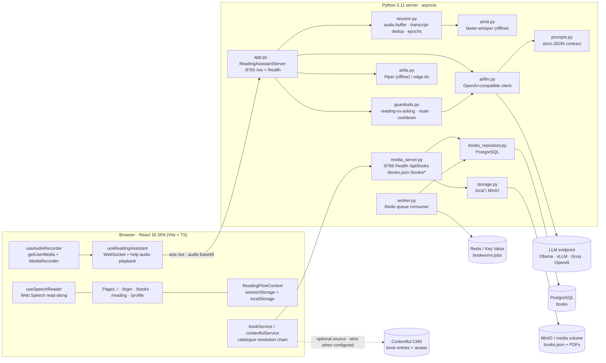
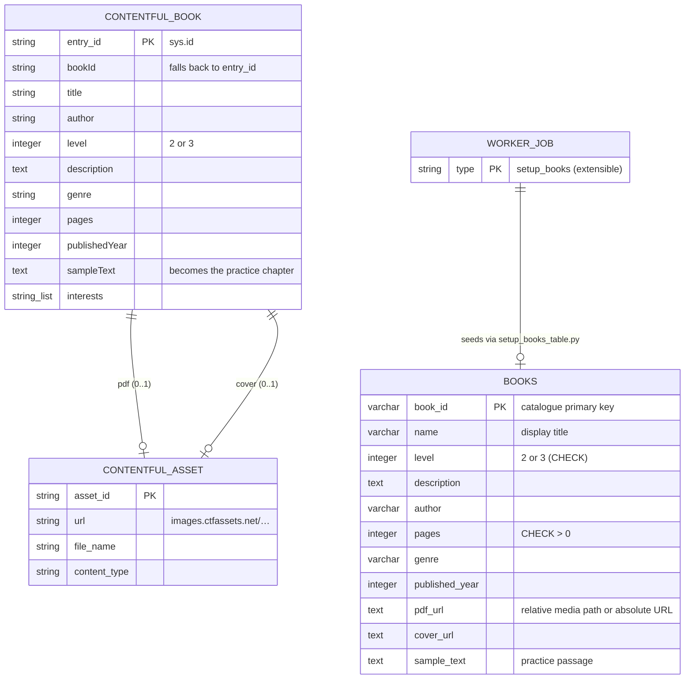
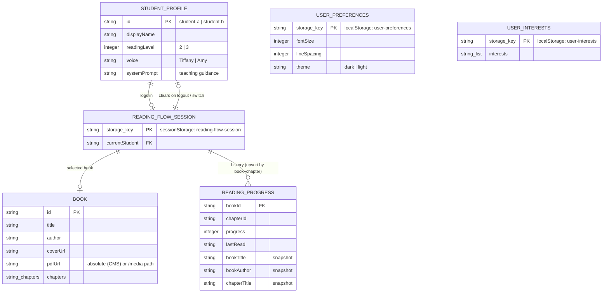
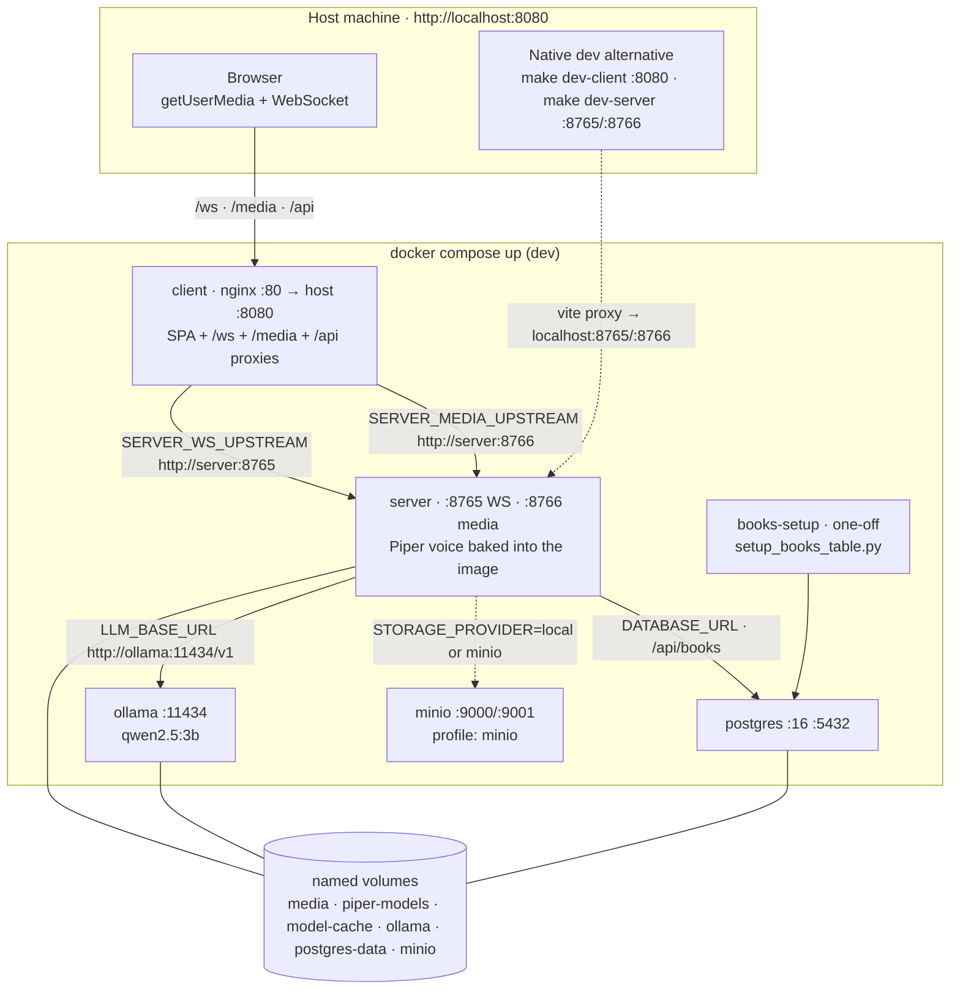
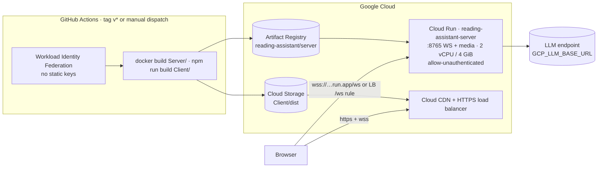
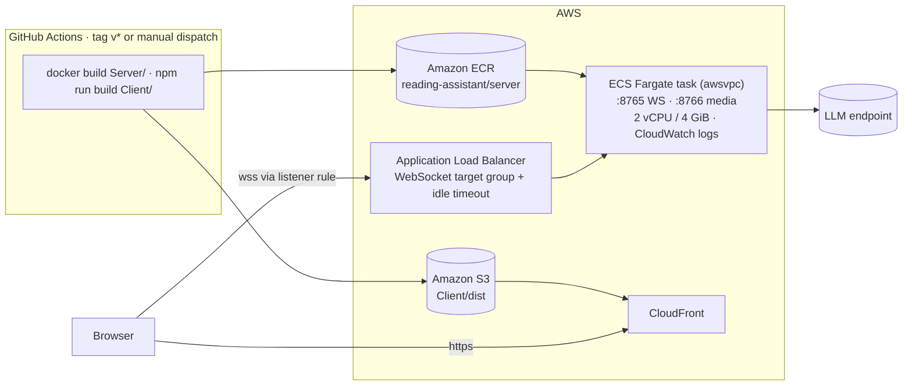
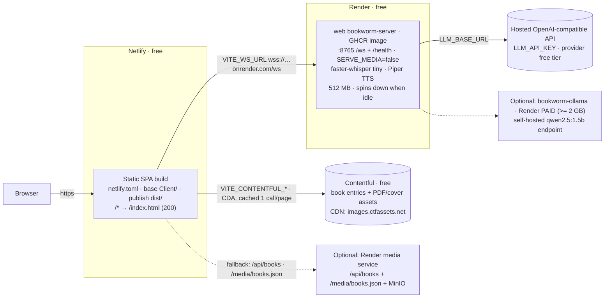

# Architecture

Interactive diagrams (GitHub renders Mermaid natively). **§1** is the logical system,
**§2** the data model (ERD), **§3–§6** the four deployment topologies.

## 1. System overview

Only the WebSocket service and the optional media server hold state; everything the child
does between page loads lives in the browser (see the client ERD below).

## 2. Data model (ERD)

**2a. Server-side catalogue & jobs** — PostgreSQL is the relational store; Contentful is the
alternative document source the client can read directly. Only one of them is ever active for
a given deployment (see §6).

`media_server.py` exposes the same catalogue shape three ways — media index → PostgreSQL →
built-in mock (`book_data.SAMPLE_BOOKS`) — which is why the client can fall back safely.
Redis holds jobs as a JSON list (`WORKER_QUEUE`, default `bookworm:jobs`); `worker.py`
`BLPOP`s them and dispatches on `type`.

**2b. Client-side session state** — per-browser, no accounts: everything survives the Render
free-tier spin-down but is scoped to one browser profile (and cleared by `switchStudent`).

Storage keys and reducers live in `Client/src/contexts/readingFlowState.ts` (pure, unit-tested);
profile/interests/preferences are written through `useLocalStorage`
(`user-interests`, `user-preferences`, `theme`).

## 3. Local stack (Docker Compose / native dev)

`make up` also seeds the media and Piper volumes from `./media` and `./Server/models`.
`docker-compose.prod.yml` exposes only nginx on port 80; `docker-compose.bind.yml` swaps named
volumes for host bind mounts; `docker-compose.gpu.yml` enables `WHISPER_DEVICE=cuda`.

## 4. GCP production stack (`.github/workflows/deploy-gcp.yml`)

Setup details: [docs/deployment-gcp.md](docs/deployment-gcp.md). Books live on the Cloud Run
instance volume (`/data/media`) or a GCS mount.

## 5. AWS production stack (`.github/workflows/deploy-aws.yml`)

Task definition: [`deploy/aws/ecs-task-definition.json`](deploy/aws/ecs-task-definition.json)
(ports 8765/8766, `/health` container health check, `SERVE_MEDIA=true`).
Setup details: [docs/deployment-aws.md](docs/deployment-aws.md).

## 6. Hybrid free demo — Netlify + Render + Contentful

Every layer sits inside a free plan; see
[docs/deployment-render.md](docs/deployment-render.md) for the walkthrough.

`bookService.ts` resolves the catalogue in order — **Contentful → `/api/books` →
`/media/books.json` → bundled samples** — so the demo keeps working if the CMS or the WebSocket
service is cold or unreachable. Two services can never be free on Render (background workers,
and Ollama needs ≥ 2 GB RAM), which is exactly why the demo pushes the catalogue to Contentful
and the LLM to a hosted API.

Replacing Netlify with Render's own nginx image (or moving everything onto one platform) is the
**full-stack variant**: [`deploy/render/full-stack.yaml`](deploy/render/full-stack.yaml)
(client + WebSocket + media + MinIO + Redis worker + PostgreSQL).

## Topology comparison

| Concern | Local (compose) | GCP | AWS | Hybrid free demo | Full-stack Render |
|---|---|---|---|---|---|
| SPA hosting | nginx container `:8080` | GCS + Cloud CDN | S3 + CloudFront | Netlify | client nginx web service |
| WebSocket API | `server:8765` | Cloud Run `:8765` | ECS Fargate behind ALB | Render free `:8765` | `bookworm-server-ws` |
| Media/API (`:8766`) | same container | same Cloud Run service | same ECS task | Contentful (or media service) | `bookworm-server-media` |
| Catalogue | PostgreSQL (compose) | `/data/media` volume | `/data/media` volume | Contentful entries | PostgreSQL + media + MinIO |
| Object storage | local volume / MinIO | GCS mount | S3 / EFS | Contentful assets | MinIO (ephemeral on free) |
| LLM | Ollama container | hosted or Ollama sidecar | hosted or `__LLM_BASE_URL__` | hosted API (free tier) | Ollama image (`standard`, paid) |
| Background jobs | `books-setup` one-off | — | — | — | Redis worker (`starter`, paid) |
| `/ws` path | nginx proxy | LB URL-map or direct `wss://` | ALB listener rule | direct cross-origin `wss://` | nginx proxy |
