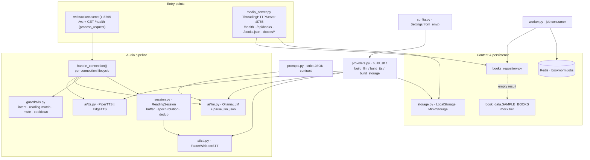
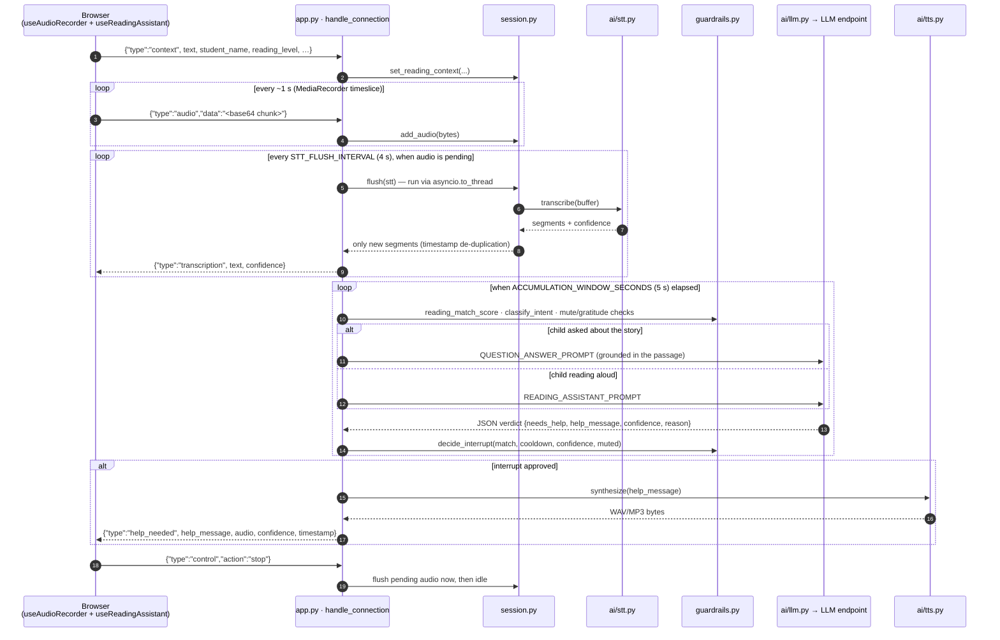
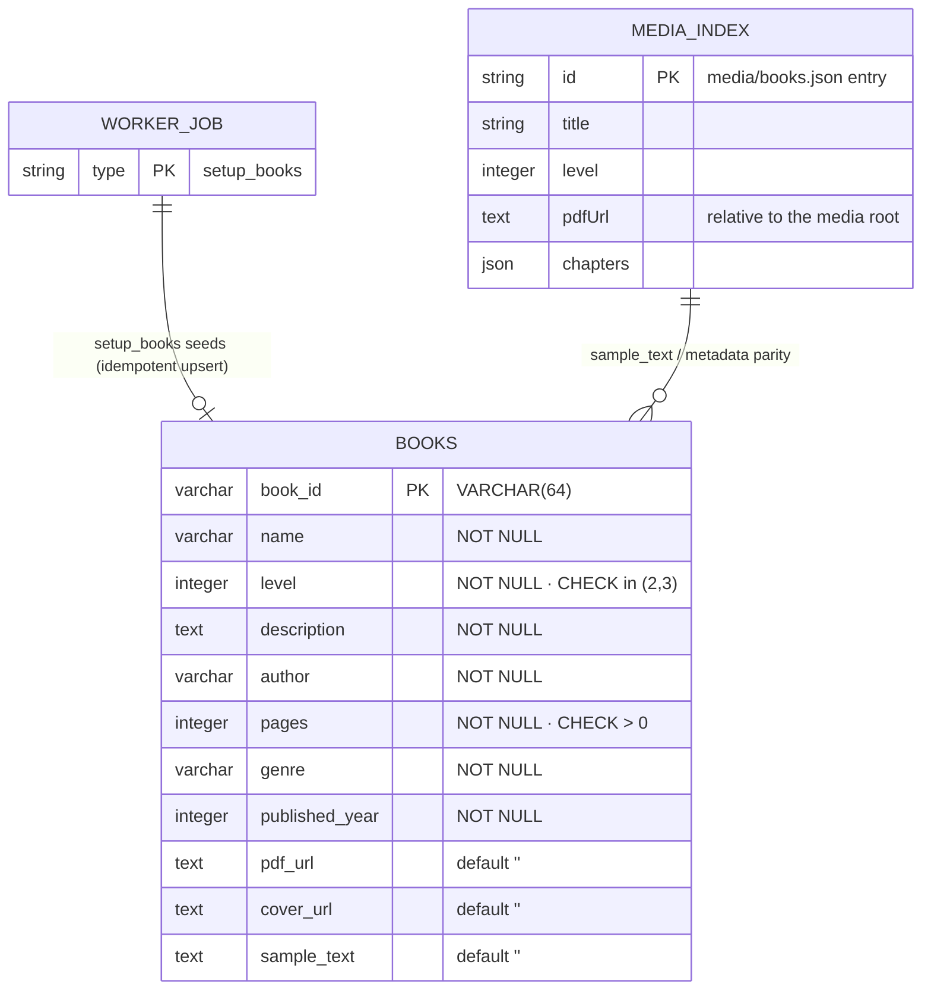

# Backend documentation

The server is a Python 3.11 asyncio application: a **WebSocket** endpoint for the audio
pipeline plus a tiny **HTTP** server for health and the media library (books). Every AI
capability sits behind a swappable provider interface — there are no cloud SDKs.

## Architecture

```
ws://…:8765  handle_connection()
     │  {"type":"audio","data":"<base64>"}      ← client chunks (WebM/Opus…)
     ▼
ReadingSession  (session.py)
     │  buffers bytes; flushes every STT_FLUSH_INTERVAL seconds
     ▼
STTClient.transcribe(file)          (ai/stt.py — faster-whisper, offline)
     │  new transcript segments (timestamp-based de-duplication)
     ▼
session.add_text() → when ACCUMULATION_WINDOW_SECONDS elapsed
     ▼
LLMClient.analyze(prompt)          (ai/llm.py — any OpenAI-compatible endpoint)
     │  JSON verdict {needs_help, help_message, confidence, reason}
     ▼  if needs_help
TTSClient.synthesize(help_message) (ai/tts.py — piper | edge_tts)
     ▼
{"type":"help_needed", …, "audio":"<base64>"}   → client (spoken back to the child)
```

### Component view



### Request flow (one reading session)



### Data model (ERD)

Server-side stores only — the browser owns session/profile/history state
(see [frontend.md](frontend.md)). PostgreSQL is optional: without `DATABASE_URL`
`books_repository` is never constructed and the media server serves the media index,
falling back to the built-in mock.



Catalogue resolution inside `media_server.py`, in order:
**media index (`books.json`) → PostgreSQL (`books` table) → `book_data.SAMPLE_BOOKS`**;
each response reports `source: "media" | "postgres" | "mock"`, and every route sends
`Access-Control-Allow-Origin: *` so the SPA can call it cross-origin (Netlify/Render split).

Redis carries jobs as a JSON list (`WORKER_QUEUE`, default `bookworm:jobs`):

```jsonc
{ "type": "setup_books" }   // → Server/setup_books_table.py (create + seed, idempotent)
```

## Module layout

| File | Responsibility |
|---|---|
| `app.py` | `ReadingAssistantServer` — connection lifecycle, flush loop, analysis, `/health` |
| `config.py` | `Settings` dataclass built from environment variables |
| `providers.py` | Factory: `build_stt` / `build_llm` / `build_tts` from `Settings` |
| `ai/base.py` | `STTClient`, `LLMClient`, `TTSClient` protocols + `Transcript` types |
| `ai/stt.py` | `FasterWhisperSTT` (CTranslate2, VAD-filtered) |
| `ai/llm.py` | `OllamaLLM` (OpenAI-compatible Chat Completions) + robust JSON parsing |
| `ai/tts.py` | `PiperTTS` (offline, default — voice baked into the Docker image) and `EdgeTTS` (online fallback) |
| `session.py` | Per-client audio buffer, epoch rotation, transcript accumulation, analysis timing |
| `guardrails.py` | `reading_match_score`, `classify_intent`, `is_mute_command`, `is_gratitude_command`, `question_relates_to_passage`, `decide_interrupt` — *whether* the assistant may speak |
| `media_server.py` | stdlib HTTP: `/health`, `/api/books?level=2|3`, `/books.json`, `/books/*` |
| `book_data.py` | `SAMPLE_BOOKS` + `books_for_level()` — the built-in mock catalogue tier |
| `books_repository.py` | PostgreSQL access for level-filtered book metadata |
| `setup_books_table.py` | Idempotent table creation, sample seeding, and verification |
| `worker.py` | Redis-queue worker (`BLPOP` → handler dispatch); reuses `setup_books_table` |
| `storage.py` | `LocalStorage` (disk) / `MinioStorage` (S3-compatible) |
| `prompts.py` | The reading-assistant prompt and its strict JSON contract |
| `healthcheck.py` | Setup verification (replaces the old AWS credential checker) |
| `scripts/download_piper_voice.py` | Fetches Piper voice files from HuggingFace |
| `scripts/e2e_smoke.py` | CLI smoke test: sends an audio file through the live pipeline |

## WebSocket protocol

```jsonc
// client → server
{ "type": "audio",   "data": "<base64 audio chunk>" }
{ "type": "control", "action": "start" }              // optional
{ "type": "control", "action": "stop" }               // flush pending audio immediately
{ "type": "context", "text": "…on-screen passage…", "reading_level": 2,
  "student_name": "…", "profile_id": "…", "voice": "…",
  "system_prompt": "…", "book_title": "…" }           // sent when a book/session starts

// server → client
{ "type": "transcription", "text": "…", "confidence": 0.98, "is_partial": false, "timestamp": "…" }
{ "type": "help_needed", "needs_help": true, "help_message": "…",
  "audio": "<base64>", "audio_format": "wav|mp3", "confidence": 0.9, "reason": "…", "timestamp": "…" }
{ "type": "error", "message": "…" }
```

Bare base64 strings are also accepted (legacy support). Audio can be any format PyAV decodes
(WebM/Opus from `MediaRecorder`, WAV, MP4…). The first chunk of a recording contains the
container header; the session retains it so buffer rotations stay decodable.

## Environment variables

| Variable | Default | Purpose |
|---|---|---|
| `HOST` / `PORT` | `0.0.0.0` / `8765` | WebSocket bind address |
| `MEDIA_PORT` / `SERVE_MEDIA` | `8766` / `true` | HTTP media server |
| `SERVE_WS` | `true` | `false` runs a **media-only** instance (used by the Render media service so `PORT` can route to `MEDIA_PORT`) |
| `ACCUMULATION_WINDOW_SECONDS` | `5` | Transcript collected per LLM analysis |
| `STT_FLUSH_INTERVAL` | `4` | Seconds between transcription flushes |
| `MAX_BUFFER_BYTES` | `20971520` | Audio bytes per session epoch before rotation |
| `STT_PROVIDER` | `faster_whisper` | STT implementation |
| `WHISPER_MODEL` / `WHISPER_DEVICE` / `WHISPER_COMPUTE_TYPE` | `base` / `cpu` / `int8` | faster-whisper tuning (`float16` on GPU) |
| `LLM_PROVIDER` | `ollama` | LLM implementation (any OpenAI-compatible endpoint) |
| `LLM_BASE_URL` / `LLM_API_KEY` / `LLM_MODEL` | `http://localhost:11434/v1` / `ollama` / `qwen2.5:3b` | endpoint + model (recommended ~2 GB; ~4 GB RAM to run) |
| `LLM_TEMPERATURE` / `LLM_MAX_TOKENS` / `LLM_TIMEOUT` | `0.3` / `500` / `30` | inference settings |
| `TTS_PROVIDER` | `piper` | `piper` (offline, default) or `edge_tts` (online) |
| `TTS_VOICE` | `en-GB-SoniaNeural` | edge-tts voice id — child-friendly: `en-US-AnaNeural` (child voice), `en-US-JennyNeural` |
| `PIPER_VOICE` / `PIPER_MODELS_DIR` | `en_US-amy-medium` / `models` | piper voice + folder — friendlier alternatives: `en_US-lessac-medium`, `en_GB-alan-low` (browse [piper-voices](https://huggingface.co/rhasspy/piper-voices)) |
| `STORAGE_PROVIDER` | `local` | `local` or `minio` |
| `MEDIA_DIR` | `media` | Location of `books.json` + `books/` |
| `MINIO_ENDPOINT` / `MINIO_ACCESS_KEY` / `MINIO_SECRET_KEY` / `MINIO_BUCKET` / `MINIO_SECURE` | — | for `STORAGE_PROVIDER=minio` |
| `REDIS_URL` / `WORKER_QUEUE` | — / `bookworm:jobs` | Background worker queue (`worker.py`; Render Key Value connection string) |

## Swapping providers (plug-and-play)

`providers.py` maps env values to classes. Example — pointing the analysis at Groq instead of
local Ollama, with **zero code changes**:

```bash
LLM_BASE_URL=https://api.groq.com/openai/v1
LLM_API_KEY=gsk_…
LLM_MODEL=llama-3.1-8b-instant
```

### Adding a new provider

1. Implement the relevant protocol from `ai/base.py` in a new module (heavy imports lazy).
2. Register it in `providers.py`.
3. Add its config knobs to `Settings` (and `.env.example`).
4. Extend the tests with a fake of it (see `tests/conftest.py` for the pattern).

## Background worker (Redis)

`worker.py` is the only piece that runs outside the request path. It blocks on
`BLPOP <WORKER_QUEUE>` and dispatches each JSON job to a handler in `HANDLERS`:

```bash
# run it (needs REDIS_URL; DATABASE_URL for jobs that touch PostgreSQL)
REDIS_URL=redis://localhost:6379 python worker.py

# enqueue a job from any service that shares the Redis instance
redis-cli -u "$REDIS_URL" LPUSH bookworm:jobs '{"type": "setup_books"}'
```

| Job type | Handler | Effect |
|---|---|---|
| `setup_books` | `setup_books_table.main()` | Creates + seeds the PostgreSQL `books` table (idempotent upsert) |

Jobs are removed when picked up and failures are logged, not retried — add a retry
queue or a dead-letter list before putting anything critical on it. New job types are
registered in `HANDLERS`; the worker image (`deploy/worker/Dockerfile`) layers
`worker.py` onto the server image, so it inherits every provider and dependency.
On Render this service is a **background worker** (paid-only) with `REDIS_URL` wired to a
Key Value instance — see `deploy/render/full-stack.yaml`.

## Deployment topologies

The server is deployment-agnostic — it only needs `PORT`/`MEDIA_PORT` (or `SERVE_WS=false`
for a media-only instance), an LLM endpoint, and optionally `DATABASE_URL` +
storage settings. Diagrammed stacks (README):

| Topology | Server runs on | Notes |
|---|---|---|
| Local (compose) | `server` container, `:8765`/`:8766` | nginx client proxies `/ws`, `/media`, `/api`; Postgres + MinIO in the same network |
| GCP | Cloud Run (WebSockets, 2 vCPU / 4 GiB) | client on Cloud Storage + CDN; WIF auth ([docs/deployment-gcp.md](deployment-gcp.md)) |
| AWS | ECS Fargate behind an ALB WebSocket target group | client on S3 + CloudFront ([docs/deployment-aws.md](deployment-aws.md)) |
| Hybrid (free) | Render free web service, `SERVE_MEDIA=false` | client on Netlify, catalogue in Contentful ([docs/deployment-render.md](deployment-render.md)) |
| Full-stack Render | `bookworm-server-ws` + `bookworm-server-media` | same image twice (one per public port), MinIO/Redis/Postgres alongside |

## Health endpoints

- `GET http://…:8765/health` — WebSocket server liveness (used by the Docker `HEALTHCHECK`)
- `GET http://…:8766/health` — media server liveness
- `python healthcheck.py [--deep]` — verifies media library, LLM endpoint reachability, TTS
  voice presence; `--deep` also loads the Whisper model

## Running

```bash
make dev-server        # native: python Server/app.py (uses root .env)
make up                # docker: server + client + ollama
make logs              # follow
```

## Tests

```bash
cd Server && .venv/bin/python -m pytest -q
```

- `test_session.py` — buffering, de-duplication, epoch rotation, analysis window
- `test_llm.py` — JSON parsing (fences/prose), `response_format` negotiation with retry
- `test_ws.py` — **E2E**: real websockets server + client with fake STT/LLM/TTS providers,
  exercising audio → transcription → help_needed, error handling, `/health`, and control-stop

`tests/conftest.py` contains the fake providers (`FakeSTT`, `FakeLLM`, `FakeTTS`) and
`make_settings()` — reuse them when testing new providers.

