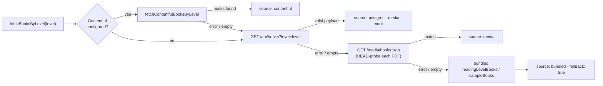
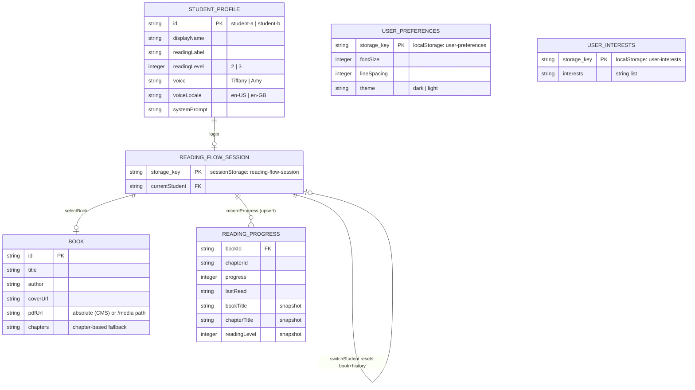

# Frontend documentation

React 18 single-page app (Vite + TypeScript + Tailwind CSS + shadcn/ui) that renders the
library and the reading experience, captures microphone audio, and talks to the Python
server over a native WebSocket. Chapter-based books also support browser-local read-along
narration with synchronized word highlighting.

## Stack

- **Vite 5** dev server (port 8080) with `/ws` and `/media` dev proxies
- **react-router-dom** routes: `/` (landing page) → `/login` (Student Login) → `/books`
  (Book Selection) → `/reading` (Reading Session) → `/profile`, plus 404. `/login`, `/books`,
  and `/reading` render one shared protected flow controller; `/books`, `/reading`, `/interests`,
  and `/profile` are
  intentionally omitted from the navbar and are reachable only with an active student session
  (unauthenticated visits redirect to `/login`, and `/reading` without a chosen book falls
  back to `/books`). `/welcome` redirects to `/` for backward compatibility
- **@tanstack/react-query**, **framer-motion**, **lucide-react**, shadcn/ui components
- **vitest** + **@testing-library** for tests

## Architecture

```mermaid
flowchart TB
    subgraph Routing["Routes (react-router-dom)"]
        L["/ · Landing"] --> LG["/login · Student Login"]
        LG --> BK["/books · Book Selection"]
        BK --> RD["/reading · Reading Session"]
        RD --> PR["/profile · Profile + history"]
        IN["/interests"]
    end

    subgraph State["State"]
        Ctx["ReadingFlowContext<br/>currentStudent · selectedBook · readingHistory"]
        LS["useLocalStorage<br/>user-interests · user-preferences · theme"]
    end

    subgraph Hooks["Hooks"]
        Rec["useAudioRecorder"]
        Asst["useReadingAssistant"]
        Speak["useSpeechReader"]
    end

    subgraph Services["Services"]
        BS["bookService"]
        CFS["contentfulService"]
        WSM["wsMessages (pure parser)"]
    end

    Guard["RequireStudent<br/>login / books / reading / profile"]
    SS[("sessionStorage<br/>reading-flow-session")]
    LSS[("localStorage")]
    API["GET /api/books?level=2|3<br/>GET /media/books.json"]
    CDN[("Contentful CDA + asset CDN")]
    WSS["wss://…/ws"]
    TTS["Web Speech API (read-along)"]

    Guard --> L
    Ctx --- SS
    LS --- LSS
    Ctx --> LG & BK & RD & PR
    BK --> BS
    RD --> BS & Rec & Asst & Speak
    BS --> CFS
    BS --> API
    CFS -.-> CDN
    Asst --> WSM
    Asst --> WSS
    Speak --> TTS
```



Chapter-based books render in-app (read-along + styling work); PDF books render in an
iframe, so those controls are hidden.

### Catalogue resolution



`fetchBooks()` / `fetchReadableBook()` use the same order and finally fall back to the bundled
samples, so the reading page always renders something. Absolute URLs (e.g. Contentful assets)
bypass the `VITE_MEDIA_URL` prefix, and CMS books skip the cross-origin `HEAD` probe
(`normalizeApiBook` / `resolveMediaUrl` in `src/services/bookService.ts`).

### State & persistence (ERD)

There are no accounts: the profile, chosen book, history and preferences live in the browser,
which is also what lets the free hybrid demo survive server spin-downs.



Reducers live in `src/contexts/readingFlowState.ts` (`login`, `update-student`, `select-book`,
`record-progress`, `clear-history`, `switch-student`) and are unit-tested; history entries carry
a book snapshot so the Profile page needs no catalogue lookup.

### Split deployment (free demo)

Point `VITE_WS_URL` at the Render service and set the `VITE_CONTENTFUL_*` variables to serve
the catalogue from the CMS instead of the media server; everything else (routing, state,
read-along) is unchanged. Walkthrough: [docs/deployment-render.md](deployment-render.md).

## The audio pipeline (E2E)

```
useAudioRecorder                        useReadingAssistant
  getUserMedia({audio:true})              new WebSocket(resolveWsUrl())
  MediaRecorder (webm/opus)   base64  →   send {"type":"audio","data":…}
  1-second timeslice chunks               ← {"type":"transcription", …}   live transcript
                                           ← {"type":"help_needed", …, "audio":…}
                                             plays data:audio/<fmt>;base64,… via Audio
```

The `Reading` page composes both hooks: `useAudioRecorder({ onChunk: assistant.sendAudio })`.
One mic toggle starts/stops streaming; the sidebar shows the transcript and the assistant's
spoken help messages.

Microphone controls are server-dependent: they are enabled only when the assistant status is
`connected`, and active recording stops when the WebSocket drops. Connecting, reconnecting,
idle, and error states all keep both the floating and sidebar mic controls disabled.

## The read-along pipeline (browser-local)

```
chapter content → tokenizeSpeechText → SpeechSynthesisUtterance → selected narrator voice
       │                                            │
       └──── HighlightedText ← active token index ──┘
```

`useSpeechReader` runs entirely in the browser, so read-along remains available when the
assistant server is offline. It ranks installed voices and prefers Natural, Neural, Premium,
Google US English, Microsoft Aria/Jenny/Ana, and clear macOS narrators such as Samantha while
deprioritizing novelty/robotic voices. Narration uses a calm `0.92` rate and natural pitch.

Word synchronization uses `SpeechSynthesisUtterance.onboundary` when the browser provides it.
For engines that do not emit reliable word boundaries, the fallback highlights the first word
when audio starts, catches up from total elapsed narration time, and accounts for word length,
speech rate, punctuation pauses, and timer drift.

Read-along and reader font settings apply only to chapter-based books whose text is rendered
in the app. PDF books are embedded in an iframe; the app cannot tokenize or restyle that
cross-document text, so it hides the ineffective settings/read-along controls for PDFs.

## Floating reader controls

- The toolbar is collapsible to one compact expand button.
- When the assistant sidebar is open, it moves left of the sidebar on desktop.
- On small screens it moves above the sidebar footer, avoiding the **Clear transcript** button.
- The microphone remains present for PDF books; only chapter-specific controls are hidden.

## Key modules

| Module | Responsibility |
|---|---|
| `src/hooks/useAudioRecorder.ts` | Mic permission, MediaRecorder lifecycle, blob → base64, mime negotiation (`webm;codecs=opus` → fallbacks) |
| `src/hooks/useReadingAssistant.ts` | WebSocket connection with exponential-backoff reconnect, connection-readiness rule, transcript state, help playback, `resolveWsUrl()` |
| `src/hooks/useSpeechReader.ts` | Offline browser TTS, narrator voice ranking, native boundary tracking, and elapsed-time fallback synchronization |
| `src/components/HighlightedText.tsx` | Word-token rendering, active/read styling, and auto-scroll during narration |
| `src/services/wsMessages.ts` | Pure parser for server messages (unit-tested) |
| `src/components/StudentLogin.tsx` | Child-friendly StudentA/StudentB reading-profile login |
| `src/components/BookSelection.tsx` | Level-filtered book cards, loading/error states, and single selection |
| `src/contexts/ReadingFlowContext.tsx` | Shared, session-persisted student/book/reading-history state used by `/login`, `/books`, `/reading`, the navbar, and profile-page logout |
| `src/contexts/readingFlowState.ts` | Pure reducer (unit-tested): login, book selection, progress upsert, clear-history, switch-student |
| `src/services/bookService.ts` | Catalogue resolution chain: Contentful → `/api/books?level=X` → `/media/books.json` → bundled samples; resolves media URLs (absolute URLs pass through) |
| `src/services/contentfulService.ts` | Optional Contentful CMS source (entries → `Book`, asset URLs); inert unless `VITE_CONTENTFUL_*` is configured |
| `src/pages/Landing.tsx` | Public entry page at `/`; **Get Started** sends visitors to `/login` |
| `src/pages/Reading.tsx` | PDF branch (iframe) and chapter branch + assistant sidebar & floating controls |
| `src/pages/Profile.tsx` | Student profile editing, reading history with **Clear History**, and the single **Logout** (returns to `/`) |
| `src/components/Navbar.tsx` | Session-aware navigation: hides `/books`/`/reading`, shows the student profile link, disables the brand during a session |
| `src/types/index.ts` | Domain types incl. `TranscriptionEvent`, `HelpEvent`, `AssistantStatus` |

## Environment variables

| Variable | Default | Purpose |
|---|---|---|
| `VITE_WS_URL` | *(same-origin `/ws`)* | WebSocket endpoint override (`ws://host:8765`, `wss://…/ws` in the split demo) |
| `VITE_MEDIA_URL` | `/media` | Media root for `books.json` + PDFs (absolute URLs are honoured as-is) |
| `VITE_API_URL` | `/api` | Reading-level books API root |
| `VITE_CONTENTFUL_SPACE_ID` | *(unset)* | Enables the Contentful catalogue when paired with a token |
| `VITE_CONTENTFUL_ACCESS_TOKEN` | *(unset)* | Read-only Content Delivery API token (ships in the bundle) |
| `VITE_CONTENTFUL_ENVIRONMENT` | `master` | Contentful environment |
| `VITE_CONTENTFUL_CONTENT_TYPE` | `book` | Content type id for book entries |
| `VITE_CONTENTFUL_HOST` | `cdn.contentful.com` | CDA host override (e.g. `cdn.eu.contentful.com`) |

`VITE_*` values are baked in at build time. With a Contentful space configured
the CMS wins over both `/api` and `/media`; without it the platform sources run
exactly as before (see [docs/deployment-render.md](deployment-render.md) for the
free split deployment).

The same-origin defaults work everywhere because the proxies match:

| Environment | Who serves `/ws` and `/media` |
|---|---|
| Native dev | Vite dev proxies (`vite.config.ts` → `:8765` / `:8766`) |
| Docker / prod | Nginx (`nginx.conf` → `server:8765` / `server:8766`) |
| Cloud | ALB / CDN / ingress rules (see deployment docs) — keep `/ws` routed to the server |

## Development

```bash
cd Client && npm install
npm run dev          # http://localhost:8080 (proxies to the native server)
npm test             # vitest
npm run lint         # eslint
npm run build        # production bundle → dist/
```

Notes:

- `getUserMedia` requires a secure context — use `http://localhost:8080` or HTTPS.
- Books without `pdfUrl` render the chapter branch (bundled sample books have chapters).
- Books with `pdfUrl` render in an `<iframe>`; the PDF itself is served by the backend media
  server, never from a third-party CDN. Reader settings/read-along highlighting are hidden in
  this branch because they cannot affect iframe content.

## Tests

| File | Covers |
|---|---|
| `src/test/wsMessages.test.ts` | Server-message parsing: transcription / help / error / invalid / unknown |
| `src/test/wsUrl.test.ts` | `resolveWsUrl` default/override behaviour and assistant-control readiness by connection status |
| `src/test/speechReader.test.ts` | Tokenization, boundary mapping, voice ranking, punctuation-aware timing, and elapsed-time catch-up |
| `src/test/bookService.test.ts` | Media fetch + `pdfUrl` resolution, sample fallback, empty catalogue, source priority, absolute CMS URLs |
| `src/test/readingFlowState.test.ts` | Flow reducer: student/book session coupling, history snapshots, upsert, clear-history, switch-student reset |

## Reading history

Reading progress is stored in the shared flow context (persisted in `sessionStorage`), not in
static fixtures. `Reading.tsx` records each chapter's progress with a book snapshot
(`bookTitle`, `bookAuthor`, `bookCoverUrl`, `chapterTitle`, `readingLevel`) so the Profile
page's **History** tab renders real media/API books without consulting bundled sample data.
Entries upsert per book+chapter, **Clear History** empties the list, and switching or logging
out a student clears it with the session. **Logout** lives on the Profile page and returns to
the landing page at `/`; the legacy `/welcome` route redirects there for backward
compatibility.
